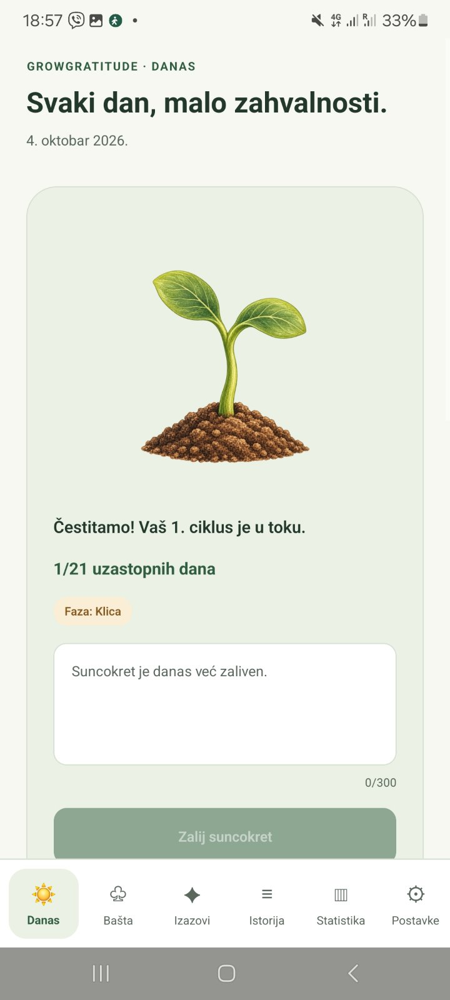
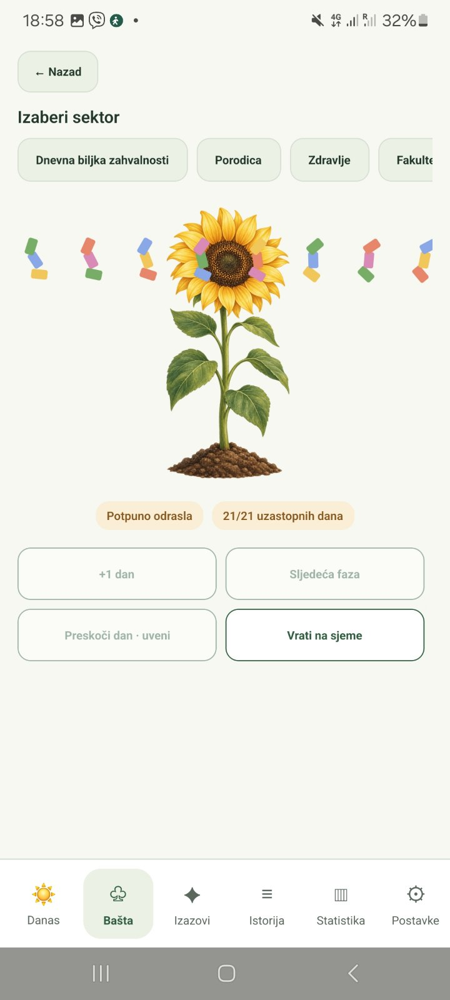
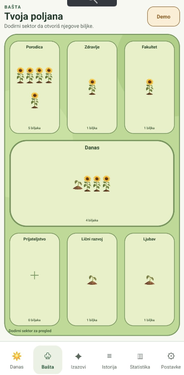
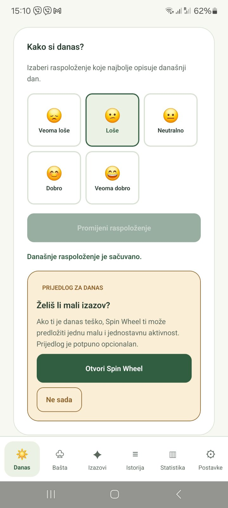
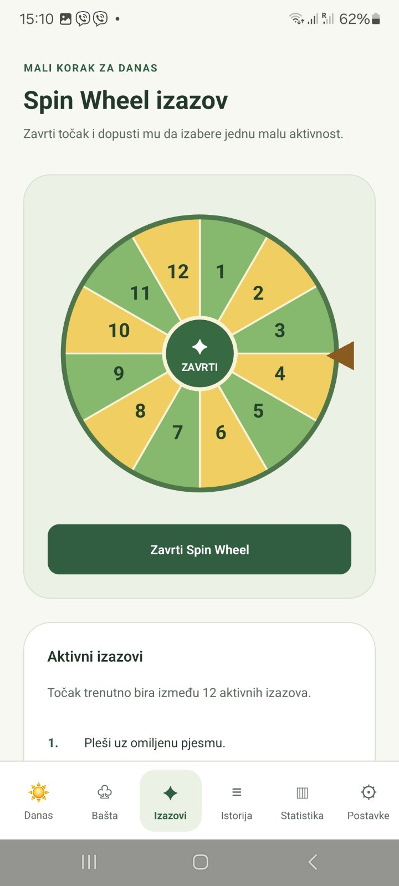
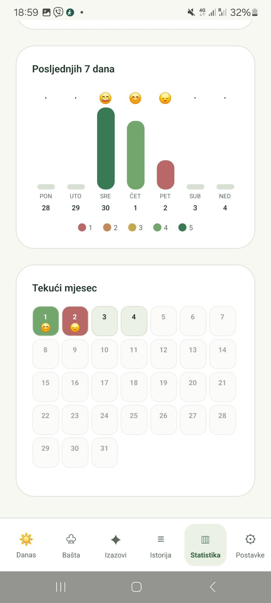

# GrowGratitude

GrowGratitude is an Android gratitude journal where each daily entry waters a virtual plant. A 21-day streak grows a seed into a sunflower that stays in the garden.

I designed and built GrowGratitude with React Native, TypeScript, and SQLite as the practical part of my bachelor's thesis on user experience and habit formation.

## Screenshots

| Daily gratitude | Completed cycle (demo mode) | Gratitude garden |
| --- | --- | --- |
|  |  |  |

| Mood check-in | Spin Wheel | Mood statistics |
| --- | --- | --- |
|  |  |  |

## Project status

The Android app already supports gratitude entries, plant growth, mood tracking, reminders, and challenges. Development is ongoing, with the app and thesis planned for completion by **March 2027**.

## Core concept

The main habit cycle lasts 21 consecutive days:

- one gratitude entry waters a plant for that day;
- every successful day advances the current streak;
- the plant changes its visual growth stage as the streak progresses;
- missing a day causes the active plant to wither;
- the next watering starts a new streak at `1/21` without removing previous gratitude entries;
- reaching `21/21` completes the plant and preserves it in the garden;
- the automatic daily sunflower starts a new numbered cycle after completion.

The growth stages are:

| Streak | Growth stage |
| --- | --- |
| 0 days | Seed |
| 1–4 days | Sprout |
| 5–8 days | Small plant |
| 9–12 days | Medium plant |
| 13–16 days | Large plant |
| 17–20 days | Almost fully grown |
| 21 days | Fully grown sunflower |

Each active growth stage also has an appropriate withered visual state.

## Features

### Today

- automatic daily sunflower with numbered growth cycles;
- one gratitude entry per plant per day;
- animated watering and plant growth transitions;
- confetti feedback when a plant is fully grown;
- daily mood selection using five mood levels;
- suggestion to open the Spin Wheel after a low or very low mood entry.

### Gratitude garden

- seven garden sectors: Daily Gratitude, Family, Health, University, Friendship, Love, and Personal Growth;
- one active plant per theme;
- planting, naming, watering, viewing, and permanently deleting plants;
- display of active, withered, and completed plants by sector;
- complete plant details, cycle number, streak, last watering date, and related gratitude entries;
- demonstration mode for presenting all growth stages without waiting 21 days.

### Spin Wheel challenges

- green and yellow SVG challenge wheel;
- random selection from currently active challenges;
- built-in and user-created challenges;
- enabling, disabling, editing, and completing challenges;
- local history of completed challenges.

### History and statistics

- gratitude entries grouped by month;
- completed plant cycles;
- completed Spin Wheel challenges;
- seven-day and monthly mood overviews;
- average mood and number of recorded days;
- total gratitude entries and fully grown plants;
- total completed challenges and longest gratitude streak.

### Settings

- light and dark application themes;
- optional daily reminder with a configurable time;
- Serbian language using the Latin script and Ijekavian pronunciation;
- local challenge management.

## Technology stack

| Technology | Purpose |
| --- | --- |
| [React Native 0.87](https://reactnative.dev/) | Cross-platform mobile application framework |
| [React 19](https://react.dev/) | Component-based user interface |
| [TypeScript](https://www.typescriptlang.org/) | Static typing and domain modeling |
| [React Native Nitro SQLite](https://github.com/margelo/react-native-nitro-sqlite) | Local SQLite database access |
| [Nitro Modules](https://github.com/mrousavy/nitro) | Native module infrastructure used by Nitro SQLite |
| [Notifee](https://notifee.app/react-native/docs/overview) | Local Android notifications and scheduled reminders |
| [React Native SVG](https://github.com/software-mansion/react-native-svg) | Programmatic rendering of the Spin Wheel |
| React Native Animated API | Plant growth, watering, wheel rotation, and reward animations |
| React Native Safe Area Context | Safe layout around device cutouts and system bars |
| Jest | Automated unit and component testing |
| ESLint | Static code quality checks |

The sunflower artwork is stored as transparent PNG assets. A reusable component maps the current domain state to the correct healthy or withered illustration. Animations are applied programmatically, so the image assets remain independent from their transitions.

## Architecture

The project separates presentation, business rules, persistence, and application workflows:

```text
src/
├── assets/          # Branding and sunflower growth illustrations
├── components/      # Reusable UI and garden components
├── constants/       # Built-in gratitude themes
├── database/        # Connection, schema, migrations, seed data, row mapping
├── domain/          # Pure business rules and validation
├── navigation/      # Application navigation
├── repositories/    # SQLite data-access layer
├── screens/         # Main application screens
├── services/        # Use cases, transactions, and application workflows
├── theme/           # Color palettes and design tokens
└── types/           # Shared TypeScript domain types
```

The domain layer calculates growth stages, streak changes, missed days, completion states, and date validation without depending on the UI or database. Repositories isolate SQL operations, while services coordinate multi-step operations such as saving a gratitude entry and watering a plant in one transaction.

## Local data and privacy

All user data is stored locally in the private application storage in a SQLite database named `growgratitude.db`. The current version does not require an account and does not use a remote backend or cloud synchronization.

The database stores:

- themes and plants;
- gratitude entries;
- daily mood entries;
- challenges and challenge completions;
- application settings.

Database constraints protect important rules, including one mood entry per date, one gratitude entry per plant and date, and no more than one active plant per theme. Foreign keys and cascading deletion keep related records consistent.

The Android application declares only the permissions currently needed:

- `POST_NOTIFICATIONS` for optional daily reminders on supported Android versions;
- `INTERNET`, required by the React Native development environment for communication with Metro. The current release does not send personal application data to a server.

Notification permission is requested only when the user enables reminders.

## Requirements

For Android development:

- Windows, macOS, or Linux supported by the React Native Android toolchain;
- Node.js 22.11 or newer;
- npm;
- JDK 17;
- Android Studio;
- Android SDK and an Android emulator or physical Android device;
- Android 7.0 / API 24 or newer for the application runtime.

The current project is developed and tested primarily on Android. The repository retains the standard React Native iOS project structure, but iOS has not yet been the primary test platform.

## Installation

Clone the repository and install JavaScript dependencies:

```bash
git clone https://github.com/marija-stojanovic/grow-gratitude.git
cd grow-gratitude
npm install
```

Make sure an Android emulator is running or a physical Android device with USB debugging is connected:

```bash
adb devices
```

Start Metro in the first terminal:

```bash
npm start
```

In a second terminal, install and open the development build:

```bash
adb reverse tcp:8081 tcp:8081
npm run android
```

On Windows Command Prompt, the equivalent commands can be run as `npm.cmd start` and `npm.cmd run android`.

## Quality checks

Run the TypeScript compiler without producing build files:

```bash
npx tsc --noEmit
```

Run ESLint:

```bash
npm run lint
```

Run the automated test suite:

```bash
npm test -- --runInBand
```

The current suite contains **89 automated tests across 15 test suites**, covering core domain rules, database seed data, settings, notifications, statistics, history, mood entries, challenges, planting, watering, deletion, and illustration selection.

## Research direction and roadmap

Further development will be informed by scientific literature from mobile computing, human–computer interaction, user experience, digital well-being, behavior change, and habit formation.

Planned work includes:

- additional usability testing with users;
- evaluation of engagement and retention indicators;
- refinement of accessibility and onboarding;
- broader personalization based on user needs;
- continued privacy and security review;
- validation of design decisions through the bachelor's thesis research;
- final Android application and thesis completion by March 2027.

## Author

**Marija Stojanovic**

GrowGratitude is an original personal project created as a software engineering portfolio application and as the practical foundation for an ongoing bachelor's thesis.
